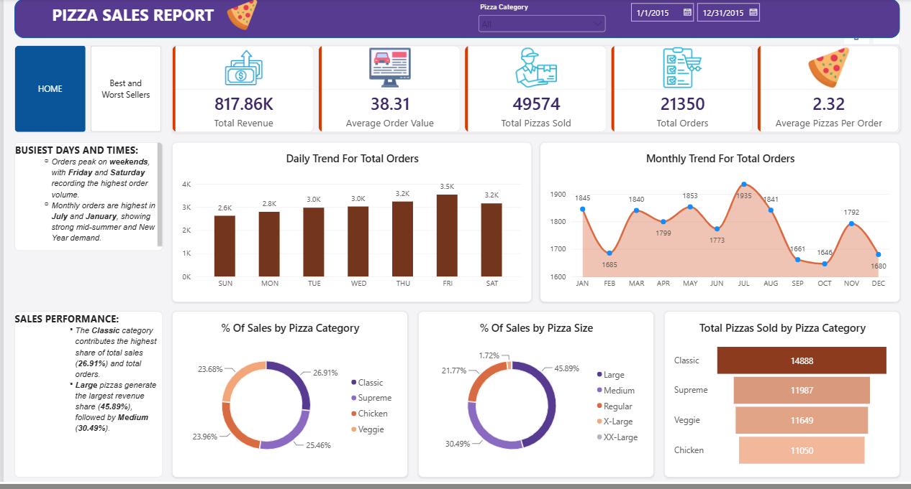
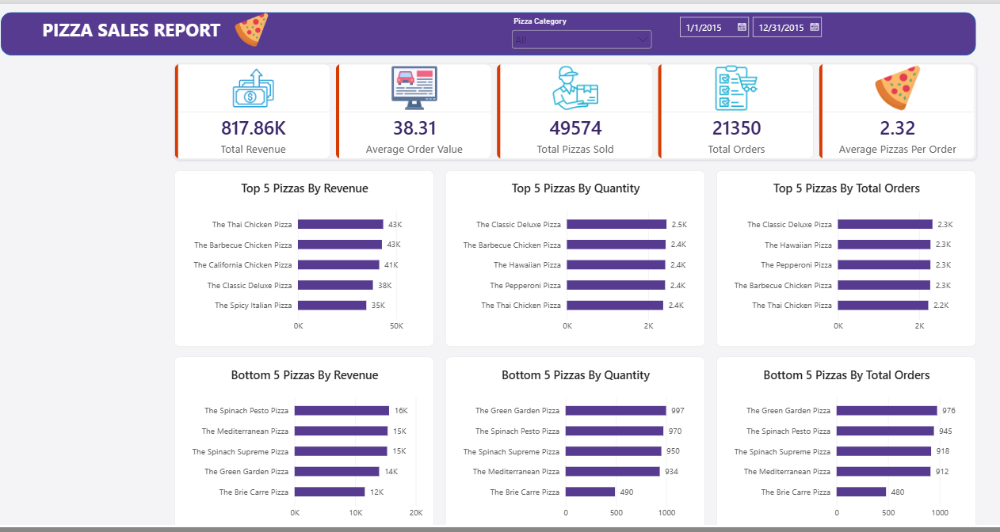

# Pizza Sales Performance & Trend Analysis Dashboard (Power BI)

## Project Overview
An interactive, two-page **Power BI** commercial sales report analyzing full-year retail transaction data (**21,350 orders** and **$817.86K in total revenue**). Built to track revenue KPIs, customer ordering patterns by day and month, category/size revenue shares, and top- vs. bottom-performing menu items.

## Tools & Skills Used
* **Power Query (ETL):** Cleaned transaction dates, standardized text categories, and prepared order-level records for reporting.
* **DAX Measures:** Created custom KPI measures for **Total Revenue ($817.86K)**, **Average Order Value ($38.31)**, **Total Pizzas Sold (49,574)**, **Total Orders (21,350)**, and **Average Pizzas Per Order (2.32)**.
* **Interactive Report Design:** Built a multi-page navigation layout (`HOME` and `Best and Worst Sellers`) featuring dynamic category and date-range slicers alongside written executive insight callouts.

## Dashboard Previews

### Page 1: Executive Overview (`HOME`)

### Page 2: Best & Worst Sellers Analysis

## Key Findings
* **Core Sales Performance:** Generated **$817.86K in total revenue** across **21,350 orders** (**49,574 total pizzas sold**), achieving an **Average Order Value of $38.31** and **2.32 pizzas per order**.
* **Busiest Days & Months:** Order volume peaked on weekends—specifically **Friday** and **Saturday**—while monthly demand reached its highest peaks in **July** and **January**, reflecting strong mid-summer and New Year sales.
* **Category & Size Drivers:** The **Classic** category led all segments with **26.91% of total sales** and **14,888 pizzas sold**, followed by **Supreme (11,987)**, **Veggie (11,649)**, and **Chicken (11,050)**. **Large** pizzas generated the largest share of revenue (**45.89%**), followed by **Medium (30.49%)**.

## Files Included
* `Pizza Sales Report.pbix` – Complete two-page Power BI Desktop report with DAX measures and page navigation.
* `pizza_sales_home.png` – Screenshot of the main executive overview page.
* `pizza_sales_best_worst.png` – Screenshot of the Best and Worst Sellers product breakdown page.

